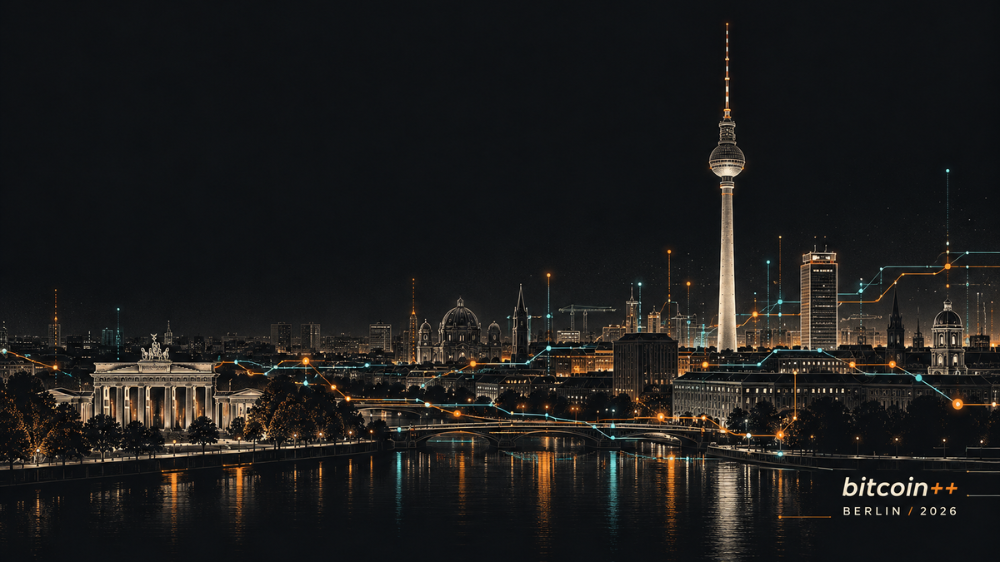

# Berlin Current

A dark Omarchy theme inspired by [bitcoin++ Berlin 2026](https://btcpp.dev/berlin26)
and its payments edition. Charcoal surfaces, Bitcoin orange, electric cyan and
warm white text, with Berlin's skyline connected by luminous payment routes.



## Install

```bash
omarchy theme install https://github.com/murdawkmedia/omarchy-berlin-current-theme
```

Built for Omarchy's `colors.toml` theming system. Omarchy generates the
application configurations from the palette. The included wallpaper is 16:10;
the gallery preview is 16:9.

## Optional screensaver

The included original ASCII artwork combines Berlin's TV Tower, city skyline,
payment routes and conference lettering. Omarchy's built-in terminal effects
animate it. The theme install command does not automatically activate this
separate branding customization.

Download the artwork from this repository and back up your current branding:

```bash
mkdir -p "$HOME/.config/omarchy/branding"
branding="$HOME/.config/omarchy/branding/screensaver.txt"
backup="$HOME/.config/omarchy/branding/screensaver-before-berlin-current.txt"
if [ -f "$branding" ] && [ ! -e "$backup" ]; then
  cp "$branding" "$backup"
fi
curl --fail --location \
  https://raw.githubusercontent.com/murdawkmedia/omarchy-berlin-current-theme/main/screensaver.txt \
  --output "$HOME/.config/omarchy/branding/berlin-current-download.txt" && \
  cp "$HOME/.config/omarchy/branding/berlin-current-download.txt" "$branding"
omarchy launch screensaver force
```

Press a key to dismiss it. To restore your saved artwork:

```bash
cp "$HOME/.config/omarchy/branding/screensaver-before-berlin-current.txt" \
   "$HOME/.config/omarchy/branding/screensaver.txt"
```

## Artwork and license

The wallpaper was generated with OpenAI image generation for this theme.
The palette and ASCII artwork were created for this project. No desktop
screenshots, personal information or third-party photographs are included.

Released under the MIT license. This is an unofficial community theme;
bitcoin++ and Omarchy names remain those of their respective owners.
